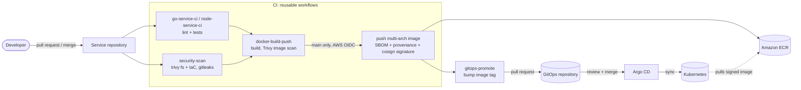

# platform-ci-templates

[](https://github.com/ozy31/platform-ci-templates/actions/workflows/self-test.yml)
[](LICENSE)

Reusable, security-first CI/CD templates for container services on AWS and
Kubernetes. The main implementation is a set of GitHub Actions
[reusable workflows](https://docs.github.com/actions/using-workflows/reusing-workflows),
with equivalents for **Bitbucket Pipelines**, **GitLab CI** and **Jenkins**,
because most platform teams run more than one CI system.

The repository tests itself: [`self-test.yml`](.github/workflows/self-test.yml)
runs the templates against a small Go service in [`demo/`](demo), so every
change to a template runs on a real build.

## Contents

- [Delivery flow](#delivery-flow)
- [Template catalog](#template-catalog)
- [Quick start](#quick-start)
- [Design principles](#design-principles)
- [AWS setup (OIDC)](#aws-setup-oidc)
- [Verifying images](#verifying-images)
- [Other CI systems](#other-ci-systems)
- [Repository layout](#repository-layout)

## Delivery flow



CI never holds cluster credentials. It produces a signed image and a pull
request against the GitOps repository; Argo CD makes the change in the
cluster. Deploys can be reviewed, audited in git history and rolled back by
reverting a commit.

## Template catalog

All workflows live in [`.github/workflows/`](.github/workflows) and are
triggered with `on: workflow_call`. "Caller permissions" are what the calling
job must grant. A reusable workflow cannot get more than its caller grants.

| Workflow | Purpose | Key inputs | Secrets | Caller permissions |
|---|---|---|---|---|
| [`docker-build-push.yml`](.github/workflows/docker-build-push.yml) | Buildx build with GHA cache, Trivy scan **before** push, multi-arch push to ECR via OIDC, SBOM + SLSA provenance attestations, cosign keyless signature | `image-name`*, `context`, `dockerfile`, `platforms`, `push`, `aws-role-arn`, `aws-region`, `scan-severity`, `sign`, `tag-rules`, `build-args` | none | `contents: read`, `id-token: write`, `security-events: write`, `actions: read` |
| [`security-scan.yml`](.github/workflows/security-scan.yml) | Trivy filesystem (dependencies) + IaC (Dockerfile, Kubernetes, Helm, Terraform), gitleaks secret scan (PR commits only on PRs), optional scan of a published image; SARIF to code scanning | `scan-path`, `severity`, `fs`, `iac`, `secrets`, `image-ref`, `aws-role-arn`, `skip-dirs` | none | `contents: read`, `security-events: write`, `actions: read` (+ `id-token: write` for private ECR images) |
| [`terraform-plan-apply.yml`](.github/workflows/terraform-plan-apply.yml) | fmt/validate/plan on PRs with a sticky plan comment; on the default branch, applies the **saved plan** in a job bound to a protected GitHub Environment | `working-directory`*, `plan-role-arn`*, `apply-role-arn`, `environment`, `terraform-version`, `init-args`, `plan-args` | none | `contents: read`, `id-token: write`, `pull-requests: write` |
| [`helm-release.yml`](.github/workflows/helm-release.yml) | `helm lint --strict`, render, package (version/appVersion override), push to ECR as an OCI artifact | `chart-path`*, `push`, `registry`, `chart-version`, `app-version`, `values-files`, `aws-role-arn` | none | `contents: read`, `id-token: write` |
| [`gitops-promote.yml`](.github/workflows/gitops-promote.yml) | Updates image tag (and digest) in a values file of a GitOps repo with `yq` and opens or updates a promotion PR; optional auto-merge | `gitops-repository`*, `values-file`*, `app-name`*, `environment`*, `image-tag`*, `image-digest`, `tag-path`, `auto-merge`, `app-client-id` | `app-private-key` (GitHub App) or `token` (fine-grained PAT) | `contents: read` |
| [`go-service-ci.yml`](.github/workflows/go-service-ci.yml) | `go mod verify`/`tidy -diff`, gofmt, vet, golangci-lint v2, race tests, coverage gate, build | `working-directory`, `golangci-lint-version`, `race`, `coverage-min` | none | `contents: read` |
| [`node-service-ci.yml`](.github/workflows/node-service-ci.yml) | `npm ci` (install scripts disabled by default), `npm audit signatures`, lint, test, build | `working-directory`, `node-version`, `ignore-scripts`, `test-command` | none | `contents: read` |

`*` = required. Every workflow also accepts `runs-on` (except
`gitops-promote`), so the same templates work on self-hosted runners.

**Outputs.** `docker-build-push` returns `image`, `digest`, `version` and
`sha-tag`, which go straight into `gitops-promote`. `helm-release` returns
`chart-ref`. `terraform-plan-apply` returns `has-changes`.

## Quick start

A service repository's `.github/workflows/ci.yml`:

```yaml
name: ci
on:
  pull_request:
  push:
    branches: [main]

permissions: {}

jobs:
  test:
    uses: ozy31/platform-ci-templates/.github/workflows/go-service-ci.yml@v1.0.0
    permissions:
      contents: read

  image:
    needs: test
    uses: ozy31/platform-ci-templates/.github/workflows/docker-build-push.yml@v1.0.0
    permissions:
      contents: read
      id-token: write
      security-events: write
      actions: read
    with:
      image-name: team/payments-api
      push: ${{ github.event_name == 'push' }}
      aws-role-arn: arn:aws:iam::123456789012:role/gha-payments-api-ecr-push

  promote-staging:
    if: github.event_name == 'push'
    needs: image
    uses: ozy31/platform-ci-templates/.github/workflows/gitops-promote.yml@v1.0.0
    permissions:
      contents: read
    with:
      gitops-repository: example-org/gitops
      values-file: apps/payments-api/staging/values.yaml
      app-name: payments-api
      environment: staging
      image-tag: ${{ needs.image.outputs.sha-tag }}
      image-digest: ${{ needs.image.outputs.digest }}
      app-client-id: ${{ vars.GITOPS_APP_CLIENT_ID }}
    secrets:
      app-private-key: ${{ secrets.GITOPS_APP_PRIVATE_KEY }}
```

More complete callers are in [`examples/github-actions/`](examples/github-actions):
Go service, Node service, Terraform and Helm chart release.

> Pin templates to a tag for readability, or to a full commit SHA for
> immutability. Dependabot's `github-actions` ecosystem updates either form.

## Design principles

**OIDC over long-lived keys.** No workflow accepts an AWS access key. Jobs
request a GitHub OIDC token and exchange it for short-lived credentials via
`sts:AssumeRoleWithWebIdentity`. The same pattern is used in the Bitbucket
(`oidc: true`), GitLab (`id_tokens`) and Jenkins (IRSA / EKS Pod Identity)
variants. A leaked CI variable therefore cannot be replayed from outside CI.

**Least privilege by default.** Every workflow starts from
`permissions: {}` and grants per job only what it needs. Terraform supports
separate plan (read-only) and apply roles. GitOps promotion prefers a GitHub
App token limited to one repository with `contents` and `pull-requests`
write.

**Pinned supply chain.** Third-party actions are pinned to full commit SHAs
with the version in a comment (`uses: org/action@<sha> # vX.Y.Z`), so a
re-pointed tag cannot change what runs. Binaries downloaded in scripts
(gitleaks, yq) are verified against a pinned SHA-256. Dependabot keeps all of
these current.

**Scan before you ship.** The image is built and loaded locally, scanned with
Trivy, and only pushed if the scan passes. Results go to GitHub code scanning
as SARIF so they show up on the pull request. Secret scanning on PRs only
looks at the commits the PR adds.

**Signed, attested artifacts.** Pushed images carry a BuildKit SBOM and SLSA
provenance (`mode=max`) and are signed with cosign keyless signing. The
signing certificate records the workflow identity, so a cluster admission
policy (Kyverno, Sigstore policy-controller) can require that images were
built by *this* template from a protected ref.

**GitOps promotion, not `kubectl` from CI.** CI ends by opening a pull request
against the GitOps repository. Argo CD reconciles the cluster. Production
promotion is a reviewed merge, and rollback is a revert.

**Safe concurrency.** PR runs cancel superseded runs. Terraform applies are
queued per root module and never cancelled mid-apply. Promotion runs are
serialised per app and environment.

**Fork-safe.** SARIF upload is skipped on fork PRs, which only get a
read-only token. No workflow uses `pull_request_target`.

## AWS setup (OIDC)

1. Create the IAM OIDC identity provider `token.actions.githubusercontent.com`
   with audience `sts.amazonaws.com` (once per account).
2. Create a role per purpose and restrict the trust policy to the repository
   and ref:

```json
{
  "Version": "2012-10-17",
  "Statement": [
    {
      "Effect": "Allow",
      "Principal": {
        "Federated": "arn:aws:iam::123456789012:oidc-provider/token.actions.githubusercontent.com"
      },
      "Action": "sts:AssumeRoleWithWebIdentity",
      "Condition": {
        "StringEquals": {
          "token.actions.githubusercontent.com:aud": "sts.amazonaws.com",
          "token.actions.githubusercontent.com:sub": "repo:example-org/payments-api:ref:refs/heads/main"
        }
      }
    }
  ]
}
```

3. Give the role only what the job needs, for example ECR push to one
   repository: `ecr:GetAuthorizationToken` plus `ecr:BatchCheckLayerAvailability`,
   `ecr:InitiateLayerUpload`, `ecr:UploadLayerPart`,
   `ecr:CompleteLayerUpload`, `ecr:PutImage`, `ecr:BatchGetImage` on that
   repository's ARN.

For Terraform, the `apply` job runs in a GitHub Environment, so its `sub`
claim is `repo:<org>/<repo>:environment:production`. Trust the apply role
only for that subject and the plan role for `pull_request` / branch subjects.

## Verifying images

Images signed by `docker-build-push.yml` can be verified with:

```sh
cosign verify \
  123456789012.dkr.ecr.eu-central-1.amazonaws.com/team/payments-api@sha256:<digest> \
  --certificate-oidc-issuer https://token.actions.githubusercontent.com \
  --certificate-identity-regexp '^https://github\.com/ozy31/platform-ci-templates/\.github/workflows/docker-build-push\.yml@refs/tags/v1\.'
```

Because the workflow is reusable, the certificate identity is the template
(`job_workflow_ref`), not the calling repository. The check passes only for
images built by a released version of this template.

Attached attestations can be inspected with
`docker buildx imagetools inspect <image>@<digest> --format '{{ json .SBOM }}'`
(or `.Provenance`).

## Other CI systems

| Directory | What's inside |
|---|---|
| [`bitbucket/`](bitbucket) | `bitbucket-pipelines.yml` with anchored step templates, self-hosted runner labels, OIDC to AWS, deployment environments (manual production), plus notes and config for [autoscaling runners on Kubernetes](bitbucket/README.md#autoscaling-self-hosted-runners-on-kubernetes) |
| [`gitlab/`](gitlab) | Hidden-job templates consumed with `include:` + `extends:`; shared `rules:`, OIDC via `id_tokens`, MR security widget report, environments, GitOps MR via push options |
| [`jenkins/`](jenkins) | Shared library (`vars/containerPipeline.groovy`) with a declarative pipeline on an ephemeral Kubernetes agent pod using rootless BuildKit |

## Repository layout

```
.github/
  workflows/          reusable workflows + self-test.yml
  dependabot.yml      keeps pinned actions, Go modules and base images current
bitbucket/            Bitbucket Pipelines + runner autoscaler notes
demo/                 Go service, distroless Dockerfile and Helm chart used by self-test
examples/
  github-actions/     caller workflows for service and infra repositories
gitlab/               GitLab CI templates and example pipeline
jenkins/              Jenkins shared library
```

### Self-test

`self-test.yml` runs on every PR and push to `main` with **no secrets
required**:

- `actionlint` (with shellcheck) on all workflows, YAML validation of the
  other templates
- `go-service-ci` on `demo/`
- `security-scan` on the whole repository
- `docker-build-push`: build and scan, and push and sign only on `main`
  when the repository variable `AWS_ROLE_ARN` (and optionally `AWS_REGION`)
  is set
- `helm-release`: lint, render and package `demo/chart`

Run the same checks locally:

```sh
actionlint
(cd demo && go test -race ./... && docker build -t demo:local .)
helm lint --strict demo/chart
trivy config --severity HIGH,CRITICAL .
```

## License

[MIT](LICENSE) © Ahmet Ozan Gazi
